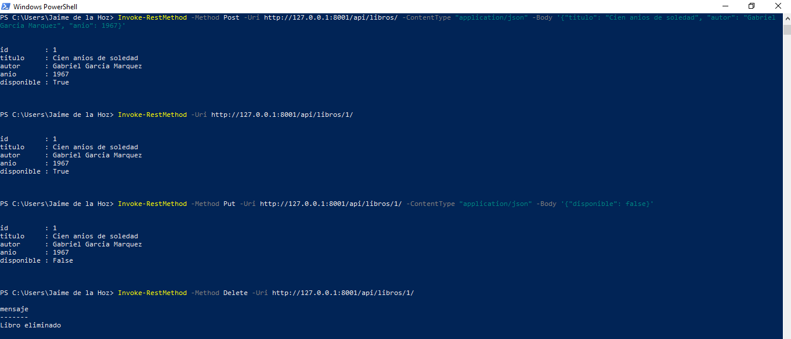

# Endpoints en Django nativo: API de libros

**Curso:** Desarrollo de aplicaciones Web I - 4E

Vista basada en clase (`LibroView`) que maneja los cuatro verbos HTTP sin librerías externas.

## Verbos HTTP y operaciones CRUD

| Verbo | Método | CRUD | Ejemplo en este proyecto | Código de respuesta |
|---|---|---|---|---|
| GET | `get()` | Read | Listar libros o ver uno por `pk` | 200 / 404 |
| POST | `post()` | Create | Registrar un libro nuevo | 201 / 400 |
| PUT | `put()` | Update | Cambiar datos o disponibilidad de un libro | 200 / 404 |
| DELETE | `delete()` | Delete | Quitar un libro del catálogo | 200 / 404 |

## Módulos, funciones y decoradores usados

| Elemento | Qué hace |
|---|---|
| `View` | Clase base; su `dispatch()` revisa el verbo y llama a `get`, `post`, `put` o `delete`. |
| `as_view()` | Convierte la clase en función para usarla en `urls.py`. |
| `JsonResponse` | Devuelve la respuesta en JSON con su código de estado. |
| `json.loads()` | Pasa el body de la petición a diccionario de Python. |
| `csrf_exempt` | Evita el 403 por CSRF en POST, PUT y DELETE desde clientes externos. |
| `method_decorator` | Permite usar `csrf_exempt` sobre la clase (`name='dispatch'`). |
| `get_object_or_404` | Busca un objeto y lanza 404 si no existe. |
| `model_to_dict` | Convierte una instancia del modelo en diccionario. |
| `path` / `include` | Definen las rutas y conectan el `urls.py` de la app con el del proyecto. |
| ORM (`objects.all()`, `create()`, `save()`, `delete()`) | Operaciones sobre la base de datos. |

## Pruebas

Las peticiones están en `pruebas.http`.

## Ejecución

    pip install django
    python manage.py migrate
    python manage.py runserver 8001

## Fuentes

- https://docs.djangoproject.com/en/stable/topics/class-based-views/intro/
- https://docs.djangoproject.com/en/stable/ref/class-based-views/base/
- https://docs.djangoproject.com/en/stable/ref/request-response/
- https://docs.djangoproject.com/en/stable/topics/http/shortcuts/
- https://docs.djangoproject.com/en/stable/topics/http/urls/
- https://docs.djangoproject.com/en/stable/howto/csrf/
- https://developer.mozilla.org/es/docs/Web/HTTP/Methods